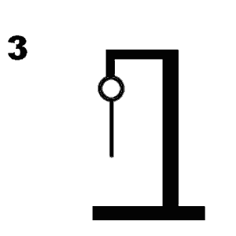

# Galgje – Git Collaboration

**Team:** <supercoolteam>  
**Spelvolgorde & contact:**
1. <Jorghinio> – <38213@ma-web.nl>
2. <Guido> – <guidomailchat>
3. <Jamil> – <jackdaarhen@gmail.com>
4. <Booker> – <email4@example.com>

---

## Woordraster
<!-- Pas het aantal kolommen aan aan de woordlengte -->
| A | e | t | h | e | r |
| - | - | - | - | - | - |
| 1 | 2 | 3 | 4 | 5 | 6 |
## Status

--- 

## Beurtenlog
- beurt1: <Guido>E
- beurt2: <Jamil> B
- beurt3: <Booker> R 
- beurt4: <Guido> L
- beurt5: <Jamil> A
- SUCCESVOL GEGOKT